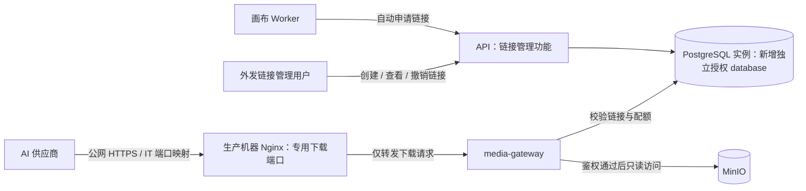

# 视频公网 URL 生成管理系统设计方案

让 AI 供应商通过临时 HTTPS 链接读取指定视频，用于视频编辑或参考视频生成。视频保留在现有私有 MinIO 中，采用以下链路：

**供应商 → 专用 HTTPS 下载入口 → 链接鉴权 → 内部读取 MinIO → 流式返回视频。**

本方案基于 [生产环境完整部署方案](生产环境完整部署方案.md)。仓库内已实现签发、撤销、下载服务与管理页面，本地真实依赖及模拟供应商验证见 [开发与验证](视频公网URL开发与验证.md)。复用现有宿主机 Nginx、API、Worker、PostgreSQL 和 MinIO，**只新增一个 `media-gateway` 下载服务容器**，不增加本地视频目录或视频副本。本文不表示已上线或已验证公网及真实供应商。

仓库内分轮实现、验证方式与完成标准见 [VibeCoding 开发计划](视频公网URL生成管理系统开发计划.md)。该计划只覆盖 MediaForge 内部开发和本地验收，不包含外部基础设施及生产上线工作。

## 1. 架构与组件职责



图中 Worker → API 表示调用共用的签发逻辑，不要求 Worker 额外通过 HTTP 调用主 API。

| 组件 | 负责什么 | 本次改动 |
| --- | --- | --- |
| 生成机器 Nginx | HTTPS、入口限流、将下载请求转发给 gateway | 新增专用站点与监听端口；`media-edge` 只是这个入口的逻辑名称，不再部署独立容器 |
| `media-gateway` | 校验链接、检查配额、读取 MinIO、流式返回视频 | 新开发并部署一个独立服务 |
| API | 检查用户/文件/任务权限，创建、查看和撤销链接 | 增加签发逻辑、管理接口和页面 |
| 画布 Worker | 执行编辑任务，自动申请链接并提交给供应商 | 接入签发逻辑；不承担供应商的视频下载传输 |
| PostgreSQL | 保存链接对应的视频、有效期、撤销状态及访问统计 | 在现有实例新增一个授权 database 和专用角色，无需新数据库容器 |
| MinIO | 保存原视频，通过专用只读账号提供对象读取 | 创建受限账号，确认对象版本与清理规则 |

“外发链接管理用户”管理的是链接。**现有内网用户从画布预览、下载视频仍走原文件访问流程，不经过新增入口或授权记录。** 用户正常发起编辑任务时，由后台自动申请链接，无需手动复制。

## 2. 一次任务如何运行

1. 用户在画布选择视频并提交编辑任务，Worker 取得内部 `file_id`。
2. 签发逻辑检查用户、素材、任务和供应商权限，核对 MinIO 对象，绑定固定对象/版本，创建临时链接。
3. Worker 将链接放入供应商的 `video_url.url`，提交任务并保存供应商任务 ID。
4. 供应商访问链接；Nginx 转发给 gateway。gateway 每次检查凭证、有效期、撤销状态及配额，通过后才读取 MinIO。
5. gateway 分块返回视频，不整文件加载到内存、不落本地磁盘。下载完成、断连或超时后释放读取连接。
6. 到期自动拒绝访问；供应商确认成功或失败后立即撤销。文件删除、权限撤回或账号禁用先完成持久撤销；取消、超时或失联时，未提交的授权撤销，已开始提交但结果未知的授权保留到 TTL，禁止自动重新提交。

URL 在即将提交供应商时生成，不在任务排队开始时生成。提交返回任务 ID 或收到 HEAD 请求，都不能视为视频已下载完成。提交结果不确定时先查询供应商任务状态，避免重复提交计费；换链接也不会自动更新已提交任务的输入。

## 3. 链接与安全规则

临时 URL 示例：

```text
https://video-fetch.example.com/fetch/v1/<grant_id>/video.mp4?token=<secret>
```

### 链接授权

- 每个链接绑定一个用户、任务、供应商连接和固定视频对象；不同任务或供应商分别签发。供应商关联用于权限和审计，不等于证明下载方身份。
- `secret` 使用安全随机源生成 32 字节，数据库只存 SHA-256 摘要，校验使用恒定时间比较。不用固定全局 Token，不使用用户会话作为下载凭证。
- 签发前检查素材是否允许外发。仅要求全局外发策略明确启用，只允许当前拥有者且在有效任务输入中的素材；共享预览权不能升级为外发权。人工管理接口沿用会话认证、页面权限及同源 CSRF 保护。
- 客户端只提交可信业务 ID，不能指定 MinIO 地址、桶、对象键或版本。下载端只使用授权记录定位对象，严格校验参数格式、长度和重复 token，不提供任意 URL 转发。
- URL 只展示一次或在服务端直接提交供应商；列表不返回 token。再次复制需要轮换凭证。明文凭证不进入长期画布、历史消息、通用任务事件或响应缓存。
- 过期、撤销、错误凭证一律拒绝；数据库或存储不可用时也拒绝，不回退为匿名下载。每次 HEAD、GET、Range 都重新校验，不缓存鉴权结果。

### MinIO 与数据库权限

- gateway 使用独立 MinIO 账号，仅允许必要视频桶/前缀的 `GetObject`，固定历史版本时增加必要的 `GetObjectVersion`。禁止列桶、上传、删除及管理权限，不能继承 API/Worker 的 root 凭据。
- gateway 的数据库角色只能执行授权校验/配额准入、受限审计写入、只返回结构版本的就绪函数，不能签发、续期、撤销或直接读取授权表与业务表。签发角色和迁移角色另设。
- 准入函数在一个事务中完成状态检查与配额扣减，不能先读后异步累加；仅在凭证有效时返回该对象的信息。使用 `SECURITY DEFINER` 时固定安全 `search_path`、限定 schema、撤销 PUBLIC 执行权，禁止动态 SQL。
- gateway 不持有供应商密钥、Redis 凭据或 `APP_SECRET_KEY`，不挂载业务数据和 Docker socket，不开放调试/管理接口。

### 保证读到同一份视频

优先绑定 MinIO 的具体非空 `version_id`，每次读取都指定该版本。没有稳定版本时，要求对象键不可覆盖，并固定大小与 ETag；实际 GET 必须附带 `If-Match`，避免检查后对象被替换。ETag 用作一致性标识，不当作 SHA-256。

对象变化、版本丢失或条件不匹配时拒绝下载，不静默读取新版本。无法固定对象身份的文件不签发。自动清理器应保留仍被有效链接引用的对象；用户明确删除时，先撤销链接再删除。签发和撤销需处理并发，不能在删除完成后又激活链接。

### 必须明确的边界

持有 URL 的人可能在有效期内下载视频；已经下载到供应商的数据无法通过撤销链接收回。对禁止外发的素材直接禁止签发。

撤销阻止后续新请求，已开始的传输可能继续到结束或总时限。首版不承诺单链接立即断流；紧急情况停止 gateway 并让 IT 关闭专用映射，**不要停止共用的 Nginx 影响现有业务**。若要求数秒内中断指定链接，需要额外实现周期复查和主动取消。

直接读取原存储意味着：gateway 失陷后，可能泄露读取账号获准访问的全部对象，因此桶/前缀范围必须尽量小。复用同机 Nginx 和 MinIO 也不提供机器级隔离，连接、带宽和存储 I/O 必须受限。

## 4. 视频下载接口

公网只开放固定下载路由和 GET/HEAD 方法，不提供登录页、管理接口、文件元数据、目录浏览或上传。Nginx 不将其他路径转发给业务 API。

| 请求/情况 | 返回行为 |
| --- | --- |
| 普通 GET | 200，完整原始视频字节，明确 `Content-Length` 和 `Accept-Ranges: bytes` |
| HEAD | 同等鉴权，只返回普通 GET 的元数据，不读取视频体；忽略 HEAD 上的 Range |
| 单段 Range | 支持闭合、开放结尾和后缀区间，返回 206、准确的 `Content-Range` 和区间长度 |
| 越界 Range | 416，附 `Content-Range: bytes */<size>`；首版拒绝多段 Range |
| If-Range | 匹配稳定强 ETag 时返回区间；不匹配/不支持的日期条件回退完整 200；仍扣完整文件预算 |
| 无效/过期/撤销链接，缺失或变化的对象 | 通用 404，不暴露内部原因；内部记录原因 |
| 配额超限 / 不支持的方法 / 依赖临时故障 | 分别返回 429 / 405 / 503 |

MP4 使用 `video/mp4`，MOV 使用 `video/quicktime`，扩展名和 MIME 必须对应真实格式。所有响应设置 `Cache-Control: no-store`、`Referrer-Policy: no-referrer`、`X-Content-Type-Options: nosniff`，不设置 Cookie，不启用 CDN/代理缓存或 304 缓存响应。不能跳转到 MinIO 预签名地址，也不向外透传 MinIO 错误 XML、存储地址或认证头。

gateway 使用独立、有界的连接池和读取线程，异步事件循环不能被同步 SDK 阻塞。按客户端速度读取，限制预取块数；不复用现有整对象读取或本地缓存方法。只在鉴权时占用数据库连接，不能随下载长期持有。响应头发送前检查存储状态；开始传输后失败只能断流，不能重放整个文件或改为 JSON 错误。

Nginx 关闭视频代理缓冲、临时落盘与压缩。gateway 设置存储连接/读取、客户端空闲和下载总时限，断连/异常时主动关闭并回收上游响应；不能认为取消异步任务就自动终止底层同步读取。

[Cloudwise Seedance 接口](cloudwise-api-docs.md)第 2784 行附近接受视频 URL 或 Asset ID。这种普通 HTTPS 文件响应符合其输入形式；文档未明确下载器对 token 查询参数、HEAD/Range、非 443 端口等的行为，因此需要真实任务验证。优先使用 HTTPS 443 和明确长度，文件编码、大小及时长还需满足具体模型限制。

## 5. 授权数据与管理功能

“授权数据”是本次新增功能，不是现有登录系统。继续使用现有 PostgreSQL 实例，新增专用 database 和角色；业务 API/Worker 负责写入，gateway 只获得受限校验权限。两库分开连接，业务操作前先在授权库提交持久撤销屏障；进程退出只会留下禁用范围，重试与维护对账不会恢复旧链接。授权库不可用时，不确认相关删除/禁用完整成功，不能假设跨库与 MinIO 操作天然原子。

| 新增表 | 保存内容 |
| --- | --- |
| `media_sources` | 文件、用户、任务、供应商，以及固定的桶/对象键/版本、大小、ETag、MIME 和保留期限；激活后对象定位不可修改 |
| `media_grants` | 授权 ID、对象绑定、token 摘要、创建/到期/撤销时间、请求次数与流量预算 |
| `media_policy_state` | 全局开关与配额、任务/文件撤销状态及可选范围配额 |
| `media_access_events` | 请求 ID、授权 ID、来源 IP、时间、方法、结果、字节数及拒绝原因 |
| `media_deliveries` | API/Worker 专用的短期加密交付记录，到期或撤销后删除，gateway 无读取权限 |

现有 API 增加创建对象绑定、签发/轮换链接、分页查询、撤销和管理员批量撤销接口；新增“视频外发链接”页面，展示状态、有效期、供应商、任务和访问统计。普通用户仅查看有权管理的记录，管理员操作留审计；创建/签发使用幂等机制，防止重试产生多个活动链接。

视频供应商调用需将现有 `local_asset_public_url()` 的直接拼接改为按任务签发。当前 `PUBLIC_MEDIA_TOKEN` 只是附加到 URL，现有登录中间件并未校验它，不能作为下载鉴权，也不能因此放行整个 `/api/files/`。

定时维护清理过期交付与 90 天前访问事件，不删除原视频；到期授权在查询中标为过期，额度按数据库时间即时释放。API/Worker 用 `APP_SECRET_KEY` 加密保存短期交付，只能在提交前重用；已提交或结果未知时不重复 POST。恢复数据库不能靠恢复出来的数据库自行识别，须保持下载入口停止，先运行仓库恢复撤销工具，关闭全局策略、作废全部旧授权并删除加密交付，再复核素材和重新启用。具体步骤见开发说明。

ACL 保存仍关闭全局外发，需管理员复核后重新启用；供应商配置保存、画布删除和账号迁移撤销相关现有链接并设置受影响任务的撤销屏障，不创建用户或供应商策略。后续签发按现有业务权限、素材归属和任务关联重新校验；旧链接不会恢复。

## 6. 部署与人员分工

### 端口和网络

复用宿主机 Nginx，新增下载专用 HTTPS 监听端口，不只依赖域名区分业务入口。示例规划如下，实际端口先核对占用：

```text
公网 video-fetch.example.com:443
    → IT 映射至服务器指定内网 IP:18443（现有 Nginx 新增监听）
    → 127.0.0.1:13001（新增 gateway 容器的回环发布端口）
    → 内部 PostgreSQL / MinIO
```

新增端口默认拒绝未知 Host 和其他路由，不能通过切换 Host/SNI 进入原业务站点。原 API 3000、MinIO 19000/19001 的回环绑定保持不变，PostgreSQL/Redis 继续不发布端口。如果公网只能提供非 443 端口，先确认供应商支持；证书应覆盖实际域名并配置自动续期，可采用企业证书流程或 DNS-01。

gateway 不继承 `x-app` 或整份生产 `.env`，采用非 root、只读根文件系统、最小 tmpfs、`cap_drop: ALL`、`no-new-privileges` 和有界日志。只接入授权库、MinIO 所需的专用容器网络，以专用凭据访问；防火墙限制到指定 API 端口，禁止任意内网/互联网、MinIO 控制台和宿主机管理服务。跨非受信网络访问存储使用校验证书的 TLS。

防火墙同时检查 IPv4/IPv6、宿主机和 Docker 转发规则。Nginx 清除并重写代理头，gateway 仅信任该代理；NAT 不保留源 IP 时不能凭用户传入的 X-Forwarded-For 做白名单。只有供应商正式提供稳定下载出口时才加 IP 白名单。下载域名不共享业务会话 Cookie。

| 工作 | 负责人 |
| --- | --- |
| gateway、签发撤销逻辑、API/Worker 接入、管理页面和测试 | 项目开发人员 |
| Docker/Compose、Nginx 专用站点、应用上线与回退 | 项目开发/运维，按生产权限执行 |
| 公网 IP、DNS、端口映射、防火墙和入口带宽控制 | IT |
| HTTPS 证书申请/续期、外网联调和故障处置 | 双方按公司流程明确分工 |

开发和测试在非生产环境完成，生产只部署验收后的镜像与配置。Nginx 配置检查通过后 reload。共享 Nginx 的配置与进程故障仍可能影响原业务，不能视为独立入口进程隔离。

## 7. 建议初始参数

以下是待联调的起步值，不是供应商保证；使用独立 `PUBLIC_VIDEO_*` 配置，外发默认关闭，不覆盖现有 `PUBLIC_BASE_URL/PUBLIC_MEDIA_BASE_URL`。

| 参数 | 起步值 |
| --- | --- |
| 默认有效期 / 普通上限 | 30 分钟 / 2 小时，首版硬上限 2 小时，无自动例外 |
| 单视频大小 | 不超过 500 MiB，且不超过供应商限制 |
| 单链接次数 | GET 64 次、HEAD 64 次，允许重试和分段下载 |
| 流量预算 | 每次 GET 保守预扣完整文件大小，单链接最多 64 倍文件大小，断连不自动退款 |
| 并发 | 总下载 16、单源 IP 4；还需设请求速率限制及全局预算 |
| 读取缓冲 | 每块 256 KiB，每连接逐块读写，不额外预取 |
| 下载总时限 | 10 分钟，另设存储与客户端空闲超时 |
| 全局活动授权素材总大小 | 默认 2 GiB；全局最多 1024 个活动授权，全局每分钟 120 次/用户每分钟 30 次签发，轮换计入 |

保守预扣用于防滥用，不代表实际流量；实际发送字节单独统计。沿用生产方案“不设置容器内存硬上限”的约束，因此线程、连接、队列和缓冲必须有界，同时监控整机内存、MinIO I/O 和带宽；不能宣称资源完全隔离。

## 8. 上线验收与日常处置

先完成内网开发和隔离测试，再开放专用映射，从一个供应商、少量用户开始灰度。上线前至少验证：

| 验证项 | 通过标准 |
| --- | --- |
| 公网隔离 | 切换 Host/SNI、访问业务 API、登录页、docs、metrics、S3 路径均不能绕过专用下载限制 |
| 授权与撤销 | 无效、过期、撤销、跨用户及禁止外发的素材被拒绝；无效凭证不访问 MinIO |
| 文件一致性 | 完整 GET 与 Range 字节正确；对象覆盖、版本缺失、条件不匹配均不读取新内容 |
| HTTP 兼容 | HEAD 无体，GET/Range 长度与 MIME 正确；测试 If-Range、越界和多段请求 |
| 权限与竞态 | 读取账号无法列桶、写入、删除、管理或读范围外对象；签发和删除/禁用并发不产生有效残留链接 |
| 故障与负载 | 依赖故障拒绝访问；慢客户端、断连、超时后读取资源释放，内存与队列不随视频大小增长，无视频落盘 |
| 真实供应商任务 | 外网 HTTPS 可达，带 token 链接能完成视频编辑任务，而非只返回任务 ID |
| 日志与恢复 | 所有层均找不到测试 token 明文；恢复备份后旧链接不会重新生效 |

Nginx access/error 日志、gateway、API/Worker、MinIO SDK、APM 和前置网关都必须脱敏，不能保存完整 URL 查询串、认证头或密钥。Nginx 原生 error log 可能包含 URL；若无法脱敏，对专用站点/路由停止持久化这类原始请求日志，改用脱敏错误事件与指标，不修改原业务日志策略。通过 `request_id/grant_id/task_id` 关联审计，区分读取字节、发送字节、正常完成和断连；审计保留期限按公司制度确定，可从 90 天起步。

gateway 提供仅本地使用的 `/health/metrics` 聚合指标：准入拒绝、下载槽位、授权库连接/等待、授权和存储耗时、读取/发送字节及中断原因，重启后清零；专用 HTTPS 模板不转发该路径。持久请求审计保存在授权库。证书临期、整机资源和公网入口总带宽仍需部署侧监控，应用限流不能避免公司链路被占满。

常规回退先关闭签发、处理活动任务并撤销授权，再关闭专用入口和停止 gateway。疑似泄露时立即撤销，必要时停止 gateway、关闭映射以断流；保留脱敏审计并核对供应商任务，避免重复计费。原有 Nginx 业务站点、画布下载和 MinIO 数据保留，不能回退成公开桶或业务端口整体公网暴露。

## 开发环境接入与初始化

开发环境按 [开发环境完整部署流程](开发环境完整部署流程.md) 使用 Docker Compose，与生产机器、数据和凭据独立。开发媒体扩展提供 gateway、一次性初始化和恢复容器；可选 HTTPS Nginx 容器仅用于开发，自签证书及入口只绑定本机，生产仍复用宿主机 Nginx。

首次准备通过 `python -m app.initialize --public-media` 统一执行，临时使用管理员凭据，创建独立授权库/角色/结构和 MinIO 只读账号；支持已有 PostgreSQL 数据卷，不依赖空卷初始化脚本。重复执行保留密码、禁用状态与外发策略，不复活旧授权。API/Worker 仍沿用原业务结构初始化，启用外发时检查授权库；gateway 启动只做受限检查，不执行任何 DDL 或授权。

授权结构版本为 v3；validator 通过无对象数据的受限函数检查版本。就绪探测与进程存活分开，失败时不对外宣称就绪。自动测试在不挂业务卷、无外网或 Docker socket 的隔离容器内运行，实际 gateway/HTTPS 镜像另用临时 Compose 项目验收。具体首次配置、命令、恢复顺序和验证边界见 [开发与验证](视频公网URL开发与验证.md)。

开发配置统一保存在 `config/dev/.env`。API/Worker、gateway、一次性初始化及恢复容器通过 Compose 白名单分别注入所需变量，不向 gateway 加载或挂载整份配置。API/Worker 不接收 validator/授权初始化管理员 DSN；gateway 不接收 writer 或业务凭据；授权管理员 DSN 只注入 media-init。开关和公共读取配置只维护一份，旧 `config/.env` 在开发运行中不自动加载。


生产环境同样采用单一配置源 `config/deploy/.env`，通过 Compose 服务白名单保持凭据边界，不再维护 gateway 独立环境文件。`project-init` 准备业务资源，`media-init` 临时获得管理员 DSN 准备授权资源，`media-recover` 仅获得 writer DSN；生产 API/Worker 也不自动加载旧挂载目录中的 `.env`。生产 gateway 额外连接关闭 masquerading 的专用接入 bridge，以发布回环下载端口；数据库和 MinIO 不连接接入 bridge。完整上线前置条件及命令见[生产部署与上线流程](视频公网URL生产部署与上线流程.md)。


下载入口支持两种 Nginx 渲染模式：域名模式保留域名/SNI 检查；纯 IP 模式使用独立 `nginx-ip.conf.template`，允许无域名 SNI 的客户端，通过 HTTP Host 检查配置的 IP。两种模式均保留路径/方法、限流、日志脱敏和 gateway 鉴权；IP/Host 检查不是供应商身份认证。正式 IP HTTPS 需要证书覆盖实际公网 IP。
